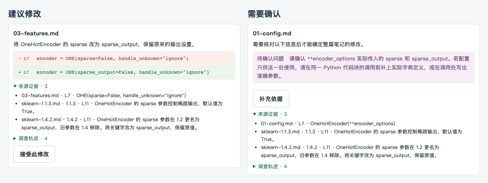

# 技术笔记迁移审阅工作台

同样是升级 scikit-learn，`OneHotEncoder(sparse=False)` 可以按版本文档把参数改为 `sparse_output=False`；遇到 `OneHotEncoder(**encoder_options)`，得先知道配置里有哪些键。工作台把这两种判断放在同一页，逐篇给出依据，由你决定哪些改动写进导出的 Markdown。



**无需模型密钥，试用五篇示例笔记。** 运行以下命令：

```sh
git clone https://github.com/Endidx/technical-note-workbench.git
cd technical-note-workbench
./run.sh
```

打开[本地资料库](http://127.0.0.1:8765/?view=library)，点击 **载入演示数据**。五篇笔记和两版资料会一起就绪。需要 Python 3.9+、JDK 17+ 和首次下载 Maven 构建依赖的网络；前端已预构建，无需安装 Node.js。

## 先试一次选择性导出

1. 打开分类特征笔记的差异，核对旧参数、目标版本的原文和行号，只接受这一篇。
2. 展开配置笔记的追问。你可以先保留原文，也可以点「补充依据」，在调用前写出实际的配置字典，再重新调查该篇。
3. 导出 ZIP。若只接受一篇改名，包中仍有五个文件，其余四份与导入原件逐字节一致。

可以点进[批次导出验证](scripts/verify_batch.py)查看这个承诺怎样计分，也可以看[补证验证](scripts/verify_clarification.py)和[GitHub Actions 工作流](.github/workflows/ci.yml)。工作流在干净的 checkout 中构建并运行，不需要模型服务或 API 密钥。

## 它怎样工作

- **上传与检索。** 两版 Markdown 资料和笔记进入不可变的索引快照。查询单条变更时，用 BM25 和向量匹配文字及语义，并提供 AST 命中解释。发起整批审阅时扫描快照里的所有笔记。
- **迁移与确认。** 批次调查在本机解析 Python 代码块，支持 KMeans 初始化策略变更和 OneHotEncoder 参数改名。资料或配置不足时记录具体问题，继续处理其余文件。单篇 Harness 另支持可选的模型判读与工具调用。
- **中断与恢复。** 每篇完成后单独持久化结果，四路并发调查绑定到同一版本快照。进程重启后继续未完成的项目；接受建议和下载 ZIP 都可以在页面中复核。

## 数据与复现

| 想验证什么 | 项目内的证据 |
|---|---|
| 为什么结合关键词和向量检索？ | [27 篇笔记、11 个查询的检索消融](examples/retrieval-eval/README.md) |
| 并发快了多少？重启是否重复工作？ | [本机 25 篇笔记三组配对计时与 SIGKILL 恢复记录](examples/batch-performance/README.md) |
| 哪些局部配置能直接修改，哪些必须追问？ | [14 篇定向回归的标注和逐篇结果](examples/batch-decisions/README.md) |
| 什么时候值得调用模型？ | [15 篇发布后留出笔记的规则与按需模型对照](examples/model-routing-study/README.md) |
| 公开项目是否真的这样改过？ | [6 个 GitHub 项目的父版本与迁移提交](examples/public-encoder/README.md) |

## 部署与材料

默认运行时使用本地 H2。需要 MySQL、RabbitMQ、MinIO、Qdrant 和 FastAPI 的组合部署时，在项目根目录运行 `docker compose up --build`。[部署与模型配置](GUIDE.md) · [第三方材料与许可](THIRD-PARTY-NOTICES.md)

自有代码采用 [MIT 许可证](LICENSE)，署名 Endidx。第三方资料沿用各自的许可。
